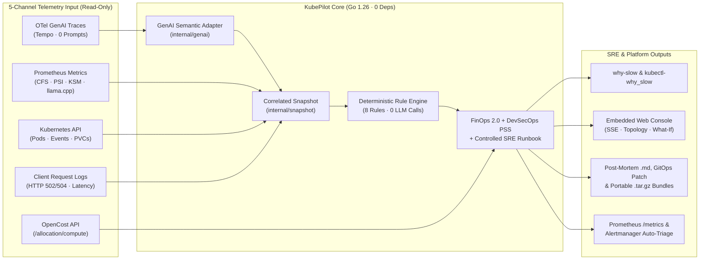

# KubePilot

[](https://github.com/iyedM/kubepilot/actions/workflows/ci.yml)
[](https://github.com/iyedM/kubepilot/releases)
[-00ADD8?logo=go&logoColor=white)](go.mod)
[](charts/kubepilot/templates/rbac.yaml)
[](LICENSE)

**KubePilot** is an open-source, self-hosted, **read-only** Kubernetes diagnosis tool and service in Go that answers one question:

> **Why was this GenAI request on Kubernetes slow, or why did it fail?**

Given a trace ID or a time window, KubePilot correlates:
- **OpenTelemetry traces** carrying `gen_ai.*` spans (from Grafana Tempo),
- **Kubernetes events and Pod/Node/PVC state**, and
- **Prometheus metrics** (cAdvisor CFS throttling, Linux PSI CPU pressure, `kube-state-metrics`, and `llama.cpp` serving metrics),

and outputs the **top-3 probable causes**, each with **timestamped evidence**, a **confidence score**, an **OpenCost Operational FinOps 2.0 ROI & waste estimate**, a **DevSecOps PSS-Restricted posture audit**, and a **controlled Human-in-the-Loop SRE runbook**. When the evidence is ambiguous, it returns **`"unknown"`** instead of guessing.

> **Methodological disclaimer:** All benchmark and baseline comparison numbers reported in this repository are measured on **faults injected in a single-cluster local `kind` lab** (`kubepilot-lab`) with one CPU-served model (`qwen2.5-0.5b-instruct-q4_k_m.gguf`), one GenAI application (`chat-api`), and synthetic traffic (`loadgen`), **not on real production incidents**.



---

## Key Features & Design Principles

- **Deterministic First (Zero LLM in the Diagnosis Loop):** Every diagnosis is produced in `< 1 s` by 8 pure, explainable Go rules in [`internal/rules/`](internal/rules/). Identical snapshots always yield identical causes and evidence.
- **Strictly Read-Only RBAC & PSS-Restricted Posture Auditor:** No pod restarting, no patching, no autoscaling, and no privileged eBPF DaemonSet (`hostPID`/`CAP_BPF`). Built-in `/api/v1/incidents/{id}/security` auditor scores workload and patch compliance (`0–100`) across 6 controls (RBAC least privilege, prompt redaction, resource limits, image tag pinning, `hostPath` isolation, and patch safety).
- **Operational FinOps 2.0 & Unit Economics:** Computes window cost/waste, **30-day projected monthly waste (`$/mo`)**, **GenAI unit economics (`$/1k requests` & `$/1M output tokens`)**, and the **monthly cost delta (`PatchMonthlyDeltaUSD`)** of the suggested GitOps remediation patch.
- **5-Channel Signal Resilience & Controlled SRE Runbook:** `/api/v1/incidents/{id}/runbook` reports per-channel health and explicit graceful-degradation fallbacks if Tempo, Prometheus, or Kubernetes Events are unavailable, alongside a 4-step human-approved remediation & rollback runbook.
- **Privacy by Default:** Prompt and completion payloads are stripped at trace ingestion and never stored in [`snapshot.Snapshot`](internal/snapshot/snapshot.go).
- **Convention-Proof `gen_ai.*` Adapter:** All unstable OpenTelemetry GenAI semantic convention names live exclusively inside [`internal/genai/adapter.go`](internal/genai/adapter.go) (documented in [`docs/genai-conventions.md`](docs/genai-conventions.md)).
- **Multiple Consumption Modes & SRE Integrations:**
  - **`why-slow` CLI / `kubectl why-slow` Native Plugin** ([`cmd/why-slow`](cmd/why-slow/main.go), [`packaging/krew/why-slow.yaml`](packaging/krew/why-slow.yaml))
  - **`kubepilot-server` HTTP API & Embedded Web UI** ([`cmd/kubepilot-server`](cmd/kubepilot-server/main.go), [`internal/server`](internal/server/server.go), [`internal/ui`](internal/ui/ui.go)) with interactive blast-radius topology, 4-lane signal swimlanes, Baseline vs. Incident comparator, DevSecOps & Runbook governance tab, real-time SSE streaming (`/api/v1/stream`), and an interactive **What-If Chaos Sandbox** (`/api/v1/simulate`)
  - **SRE Post-Mortem Markdown, GitOps Patch & Portable `.tar.gz` Bundles** (`/api/v1/incidents/{id}/postmortem`, `/api/v1/incidents/{id}/bundle`, `/api/v1/incidents/{id}/compare`)
  - **Prometheus `/metrics` Exporter, Alertmanager Auto-Triage Receiver & Official Grafana Dashboard** (`/metrics`, `/api/v1/alerts/alertmanager`, [`charts/kubepilot/dashboards/kubepilot-overview.json`](charts/kubepilot/dashboards/kubepilot-overview.json))
  - **Read-Only `GenAIIncident` CustomResourceDefinition Operator** ([`internal/operator`](internal/operator/operator.go), [`charts/kubepilot/crds/`](charts/kubepilot/crds/genaiincidents.kubepilot.io.yaml))

---

## Quickstart (60-Second Offline Demo)

You can build and test KubePilot immediately against the 64 recorded lab runs in [`eval/runs/`](eval/runs/) without spinning up a cluster:

```sh
# Run the complete 1-click end-to-end showcase (CLI + kubectl plugin + FinOps 2.0 + DevSecOps + Runbook + Simulator):
bash scripts/demo-showcase.sh

# Or step-by-step:
# 1. Build ./bin/why-slow, ./bin/kubectl-why_slow, ./bin/kubepilot-server, and ./bin/eval-score
make build

# 2. Diagnose a recorded CFS CPU throttling fault run
./bin/why-slow --run-dir eval/runs/dev/dev--cpu-throttle--limit-300m--r1

# 3. Diagnose a recorded 2000 ms pre-inference application delay
./bin/why-slow --run-dir eval/runs/dev/dev--app-delay--delay-2000ms--r1

# 4. Launch the self-hosted Web UI & HTTP API preloaded with the 19 dev runs
./bin/kubepilot-server --listen 127.0.0.1:8090 --seed-runs-dir eval/runs/dev --seed-limit 19
# -> Open http://127.0.0.1:8090
```

### HTTP API & SRE Endpoints (`kubepilot-server`)

| Endpoint | Method | Description |
|---|---|---|
| `/metrics` | `GET` | Prometheus metrics exporter (`kubepilot_incidents_by_cause_total`, `kubepilot_incident_waste_dollars_total`, etc.) |
| `/api/v1/stream` | `GET` | Real-time Server-Sent Events (SSE) stream of newly diagnosed incidents |
| `/api/v1/diagnose` | `GET` / `POST` | Diagnose a live cluster window, OpenTelemetry `trace_id`, or offline `run_dir` |
| `/api/v1/simulate` | `POST` | Interactive What-If Chaos Simulator against the unmodified deterministic Go rule engine |
| `/api/v1/alerts/alertmanager` | `POST` | Zero-touch Prometheus Alertmanager v4 webhook receiver for automatic incident triage |
| `/api/v1/incidents/{id}/compare` | `GET` | Side-by-side metric comparison between the incident window and its healthy baseline |
| `/api/v1/incidents/{id}/security` | `GET` | DevSecOps & Pod Security Standards (PSS-Restricted) posture audit + GitOps patch safety check |
| `/api/v1/incidents/{id}/runbook` | `GET` | 5-channel signal coverage resilience matrix + controlled SRE runbook with human-approval gates |
| `/api/v1/incidents/{id}/postmortem` | `GET` | Download a complete SRE Post-Mortem Markdown report with FinOps 2.0 ROI & GitOps remediation patch |
| `/api/v1/incidents/{id}/bundle` | `GET` | Export a portable `.tar.gz` bundle (`incident.json`, `postmortem.md`, `patch.yaml`, `genaiincident.yaml`) |
| `/api/v1/incidents/bundle` | `POST` | Import a portable `.tar.gz` or `.json` incident bundle into the store |

Example CLI output:

```text
Status: diagnosed
Window: 2026-10-20T12:59:11Z -> 2026-10-20T13:02:13Z

Top Probable Causes (1):
  [1] cpu_throttling (confidence=0.92, rule=cpu-throttling)
      Component: namespace=genai kind=Pod workload=deployment/model-server pod=model-server-6c974f9667-57p7c node=kubepilot-lab-worker2
      Summary:   Pod model-server-6c974f9667-57p7c (deployment/model-server) is CFS CPU-throttled (93.3% of periods throttled), increasing p50 latency x6.61 (493 ms -> 3262 ms)
      Evidence:
        - [prometheus @ 2026-10-20T13:02:00Z] container_cpu_cfs_throttled_periods_total / container_cpu_cfs_periods_total = 0.933 (1492/1600 periods) on pod model-server-6c974f9667-57p7c
        - [request_log @ 2026-10-20T13:02:10Z] request p50 latency increased to 3262.1 ms vs 493.5 ms baseline (x6.61)
        - [k8s_event @ 2026-10-20T12:59:11Z] ResizeCompleted on pod model-server-6c974f9667-57p7c
```

See [`docs/demo.md`](docs/demo.md) for the full offline and live `kind` cluster walkthrough.

---

## Pre-Registered Benchmark Results (Phase P2)

Before running a single test-split evaluation, the diagnosis engine tree (`internal/rules` tree `201576af596e12588aa27aa2e3586dd576af5fd8`) and evaluation protocol were frozen in [`eval/preregistration/2026-10-22-p2-v1.json`](eval/preregistration/2026-10-22-p2-v1.json). Reproduce at any time with `make eval-score SPLIT=test`:

| Split | Runs | `top1_accuracy` | `top3_recall` (Exit: `>= 70%`) | `evidence_precision` | `false_positive_rate_on_healthy` (Exit: `<= 10%`) |
|---|---:|---|---|---|---|
| **Held-out `test` split** | `45` (`24` faults + `21` no-fault/decoy) | **`24 / 24` (`100.0%`)** `[86.2%, 100.0%]` | **`24 / 24` (`100.0%`)** `[86.2%, 100.0%]` | **`93 / 96` (`96.9%`)** `[91.2%, 98.9%]` | **`0 / 21` (`0.0%`)** `[0.0%, 15.5%]` |
| **Development `dev` split** | `19` (`13` faults + `6` no-fault/decoy) | **`13 / 13` (`100.0%`)** `[77.2%, 100.0%]` | **`13 / 13` (`100.0%`)** `[77.2%, 100.0%]` | **`45 / 45` (`100.0%`)** `[92.1%, 100.0%]` | **`0 / 6` (`0.0%`)** `[0.0%, 39.0%]` |

Full per-cause breakdown and Wilson 95% confidence intervals: [`eval/README.md`](eval/README.md).

---

## Baseline & eBPF Evaluations (Phases P3 & P4)

### Phase P3: Comparison with Coroot Community Edition & HolmesGPT (12 Cases)

| Tool | Configuration | Fault Cases (`n = 11`): `pass` | `partial` | `miss` | Healthy Decoy (`n = 1`) | Typical Query Latency |
|---|---|---:|---:|---:|---|---|
| **KubePilot (`why-slow`)** | Deterministic Go engine (0 LLM, read-only) | **`11 / 11`** (`100.0%`) | `0 / 11` | `0 / 11` | **`1 / 1` `healthy_ok`** (`0` FP) | **`0.2–0.5 s`** |
| **Coroot Community Edition** | `v1.28.1` + `coroot-node-agent v1.37.0` | **`4 / 11`** (`36.4%`) | **`4 / 11`** (`36.4%`) | **`3 / 11`** (`27.3%`) | **`1 / 1` `healthy_ok`** (`0` FP) | **`< 0.2 s`** (after `15–45 s` scrape window) |
| **HolmesGPT (self-hosted CPU 0.5B)** | `v0.45.0` + local `Qwen2.5-0.5B-Instruct` GGUF | **`0 / 11`** (`0.0%`) | `0 / 11` | **`11 / 11`** (`100.0%`) | **`1 / 1` `healthy_ok`** (`0` FP) | **`31–164 s`** (`~33k–52k` prompt tokens) |

See [`docs/p3-comparison.md`](docs/p3-comparison.md) for the complete 12-case table and an honest breakdown of **where Coroot CE wins** (zero-code cluster-wide eBPF service maps, continuous monitoring) and **where HolmesGPT wins** (open-ended investigation across 30+ toolsets when paired with a frontier LLM).

### Phase P4: eBPF Evidence Source Evaluation (Grafana Beyla / OBI)

We evaluated **Grafana Beyla `v3.39.1`** (`go.opentelemetry.io/obi`) in both SDK+Beyla (`Mode A`) and zero-code Beyla-only (`Mode B`) configurations ([`docs/p4-ebpf-evaluation.md`](docs/p4-ebpf-evaluation.md)):
- **Mode A (SDK + Beyla):** `+0.0%` accuracy gain over the SDK baseline while generating **73.5%–78.0%** kubelet probe / Prometheus scrape trace noise in Tempo.
- **Mode B (Beyla only, SDK export disabled):** `0 / 32` chat traces carried `gen_ai.*` attributes, and broken parent-child context propagation across FastAPI worker threads caused `app-delay--delay-2000ms` to regress from `pass` to `miss` (`-100%`).
- **Decision:** Per the `CLAUDE.md` exit criterion (*"Shown to add accuracy on the benchmark first; otherwise dropped"*), KubePilot **drops** any eBPF collector from `internal/` and preserves its zero-privileged-DaemonSet architecture.

---

## Documentation Index

- **Landscape Analysis (P0):** [`docs/landscape.md`](docs/landscape.md)
- **Lab & Reproducible Faults (P1):** [`docs/lab.md`](docs/lab.md) and [`docs/genai-conventions.md`](docs/genai-conventions.md)
- **Evaluation Protocol & P2 Results (P2):** [`eval/README.md`](eval/README.md) and [`eval/faults/catalog.v1.json`](eval/faults/catalog.v1.json)
- **Baseline Comparison Report (P3):** [`docs/p3-comparison.md`](docs/p3-comparison.md) and [`eval/baselines/README.md`](eval/baselines/README.md)
- **eBPF Evaluation Report (P4):** [`docs/p4-ebpf-evaluation.md`](docs/p4-ebpf-evaluation.md)
- **System Architecture (P5–P8):** [`docs/architecture.md`](docs/architecture.md)
- **5-Minute Demo Guide (P9):** [`docs/demo.md`](docs/demo.md)

---

## License

Apache-2.0, see [LICENSE](LICENSE).
