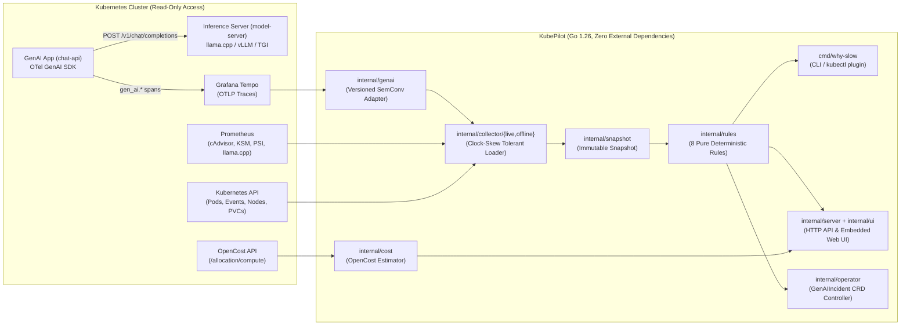

# KubePilot Architecture

KubePilot is an open-source, self-hosted Kubernetes diagnosis engine and service that answers one question: **why was a GenAI request on Kubernetes slow, or why did it fail?**

---

## 1. End-to-End Data Flow

---

## 2. Core Design Decisions

1. **Deterministic Rules First (Zero LLM in the Diagnosis Loop)**:
   - Every rule in [`internal/rules/`](../internal/rules/) is a pure function `func(*snapshot.Snapshot) []snapshot.Finding` over a point-in-time [`snapshot.Snapshot`](../internal/snapshot/snapshot.go).
   - Identical telemetry inputs always produce identical top-3 causes, confidence scores, and timestamped evidence in `< 1 second`.
   - When no rule matches the evidence, the engine returns `status: "unknown"` rather than guessing.
2. **Versioned OpenTelemetry GenAI Adapter (`internal/genai`)**:
   - Because the OpenTelemetry `gen_ai.*` semantic conventions are still in *Development* status, **all** `gen_ai.*` span attribute and metric names are isolated inside [`internal/genai/adapter.go`](../internal/genai/adapter.go).
   - The adapter transparently normalizes both `gen_ai.client.operation.duration` and `gen_ai.client.inference.duration` as well as `gen_ai.usage.{input,output,prompt,completion}_tokens`.
   - **Privacy by default:** Prompt and completion payloads (`gen_ai.prompt`, `gen_ai.completion`, `gen_ai.input.messages`, `gen_ai.output.messages`) are stripped during OTLP trace parsing and never enter `snapshot.TraceSummary`.
3. **Temporal Correlation with Clock-Skew Tolerance & Reset Exclusion**:
   - Every [`snapshot.Window`](../internal/snapshot/snapshot.go) carries a configurable `SkewTolerance` (default `30s`) when correlating spans from Tempo, Kubernetes Events from `kube-apiserver`, and range series from Prometheus.
   - Offline evaluation runs automatically exclude the post-fault reset outage window `[timeline.reset_start, timeline.lab_healthy_again)` so cleanup artifacts never pollute diagnosis.
4. **Strictly Read-Only Security Posture**:
   - Live collection ([`internal/collector/live`](../internal/collector/live/collector.go)) enforces that only HTTP `GET` queries and `kubectl get` / `kubectl logs` invocations can run.
   - The Helm chart ([`charts/kubepilot/templates/rbac.yaml`](../charts/kubepilot/templates/rbac.yaml)) grants only `["get", "list", "watch"]` on cluster resources (`pods`, `pods/log`, `events`, `nodes`, `persistentvolumeclaims`, `deployments`, `replicasets`).
   - When the optional Phase P7 operator (`--enable-operator`) is enabled, [`internal/operator`](../internal/operator/operator.go) enforces a hard URL guard refusing any mutating HTTP method outside `/apis/kubepilot.io/`.
   - Per the Phase P4 benchmark evaluation ([`docs/p4-ebpf-evaluation.md`](p4-ebpf-evaluation.md)), KubePilot does **not** deploy a privileged eBPF DaemonSet (`hostPID`, `CAP_BPF`/`CAP_SYS_ADMIN`).

---

## 3. Package Layout

| Package / Directory | Responsibility |
|---|---|
| [`cmd/why-slow`](../cmd/why-slow/main.go) | Standalone CLI and `kubectl why-slow` Krew plugin entrypoint (`--trace-id`, `--from`/`--to`, `--run-dir`, `--snapshot`, `--format text\|json`). |
| [`cmd/kubepilot-server`](../cmd/kubepilot-server/main.go) | In-cluster HTTP server, embedded Web UI, optional background polling loop, OpenCost integration, and optional `GenAIIncident` CRD controller. |
| [`cmd/eval-score`](../cmd/eval-score/main.go) | Reproducible benchmark scorer for `SPLIT=dev` and `SPLIT=test`. |
| [`internal/genai`](../internal/genai/adapter.go) | Single versioned adapter for OpenTelemetry `gen_ai.*` span attributes, OTLP trace parsing, and Prometheus metric names. |
| [`internal/snapshot`](../internal/snapshot/snapshot.go) | Flat, JSON-serializable data structures (`Snapshot`, `Window`, `TraceSummary`, `PodSnapshot`, `K8sEvent`, `Series`, `Finding`, `Report`). |
| [`internal/collector/offline`](../internal/collector/offline/loader.go) | Loads recorded lab run directories (`run.json` + `.gz` exports) with `[reset_start, lab_healthy_again)` exclusion. |
| [`internal/collector/live`](../internal/collector/live/collector.go) | Read-only live collector querying Kubernetes, Grafana Tempo, and Prometheus. |
| [`internal/rules`](../internal/rules/rule.go) | Pre-registered deterministic rule registry covering all 8 catalog causes (`cpu_throttling`, `oom_killed`, `unschedulable`, `readiness_failing`, `cold_start`, `config_change`, `host_cpu_contention`, `unknown_no_infrastructure_cause`). |
| [`internal/evalscore`](../internal/evalscore/scorer.go) | Computes `top1_accuracy`, `top3_recall`, `evidence_precision`, `false_positive_rate_on_healthy`, and 95% Wilson confidence intervals. |
| [`internal/server`](../internal/server/server.go) | Read-only REST API (`/healthz`, `/readyz`, `/api/v1/diagnose`, `/api/v1/incidents`, `/api/v1/incidents/{id}`) and bounded in-memory incident store. |
| [`internal/ui`](../internal/ui/ui.go) | Self-hosted Web UI embedded via `embed.FS` (`assets/index.html`, `assets/style.css`, `assets/app.js`). |
| [`internal/operator`](../internal/operator/operator.go) | Read-only controller for the `kubepilot.io/v1alpha1` `GenAIIncident` CustomResourceDefinition. |
| [`internal/cost`](../internal/cost/opencost.go) | Incident cost and resource waste estimator querying OpenCost (`/allocation/compute`) with a deterministic pod resource-rate fallback. |
| [`charts/kubepilot`](../charts/kubepilot/) | Helm chart packaging `kubepilot-server`, minimal read-only RBAC, and the `GenAIIncident` CRD. |
| [`packaging/krew`](../packaging/krew/why-slow.yaml) | Krew plugin manifest for `kubectl why-slow`. |
